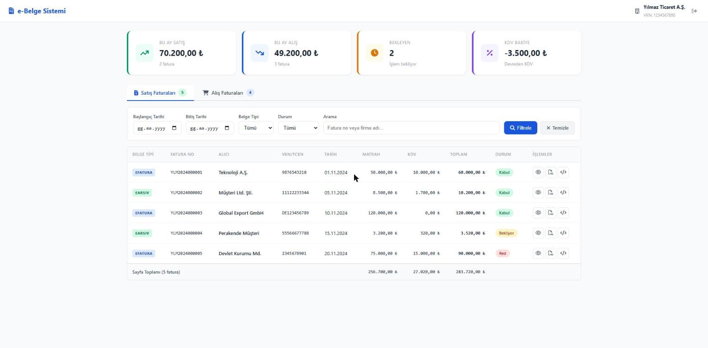
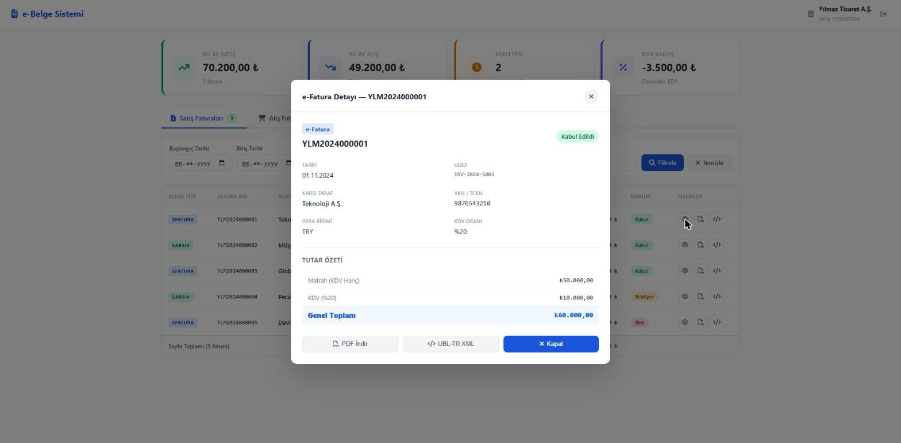

# 🧾 e-Belge Sistemi


PHP ve JavaScript ile geliştirilmiş, GİB (Gelir İdaresi Başkanlığı) özel entegratörlük altyapısına uygun **e-Fatura / e-Arşiv** alış-satış fatura yönetim uygulaması.


---

### e-Belge Özel Entegratörlük Nedir?

GİB (Gelir İdaresi Başkanlığı) tarafından yetkilendirilmiş özel entegratörler, mükelleflerin e-Fatura, e-Arşiv, e-İrsaliye gibi elektronik belgelerini kendi platformları üzerinden oluşturmasına, iletmesine ve yönetmesine aracılık eder. Entegratörlük başvurusu GİB portalı üzerinden teknik belgeler sunularak yapılır; altyapı ve güvenlik testleri geçildikten sonra yetki verilir.

---

## ✨ Özellikler

- 📊 **Dashboard** — Aylık satış, alış, bekleyen fatura ve KDV bakiyesi özet kartları
- 📄 **Satış Faturaları** — e-Fatura ve e-Arşiv satış belgelerini listeler
- 🛒 **Alış Faturaları** — Tedarikçilerden gelen alış faturalarını listeler
- 🔍 **Gelişmiş Filtreleme** — Tarih aralığı, belge tipi, durum ve metin araması
- 👁️ **AJAX Detay Modal** — Fatura detaylarını sayfa yenilemeden görüntüler
- 🧾 **UBL-TR XML İndirme** — Sunucuda üretilen sadeleştirilmiş UBL 2.1 XML (satır ve imza yok; e-İrsaliye için üretilmez)
- 🖨️ **Yazdırılabilir Fatura / PDF** — Yazdırılabilir görünüm; tarayıcıdan "PDF olarak kaydet" ile PDF alınır (demo, yasal e-Fatura görseli değildir)
- 📱 **Responsive Tasarım** — Mobil uyumlu arayüz
- 🔒 **Girdi Doğrulama ve XSS Koruması** — Sorgu parametreleri beyaz listeyle doğrulanır, çıktılar kaçışlanır, güvenlik başlıkları gönderilir
- 📝 **Açıklamalı Kod** — Tüm satırlar Türkçe yorumlarla belgelenmiştir

---

## 🗂️ Proje Yapısı

```
e-belge-project/
├── index.php                  # Ana sayfa — sekme, filtre, tablo
├── api/
│   ├── InvoiceAPI.php         # Fatura veri katmanı (GİB entegrasyon simülasyonu)
│   ├── User.php               # Mükellef kullanıcı sınıfı
│   └── invoice_detail.php     # AJAX endpoint — JSON fatura detayı
├── css/
│   └── style.css              # Tüm arayüz stilleri (saf CSS)
└── js/
    ├── app.js                 # Toast, modal, para formatlama yardımcıları
    └── invoice.js             # AJAX detay, PDF/XML indirme, tablo etkileşimleri
```

---

## 🖼️ Ekran Görüntüleri

Uygulamanın yerelde çalışan hali (demo verisiyle):





---
## 🛠️ Kullanılan Teknolojiler

| Teknoloji | Açıklama |
|-----------|----------|
| **PHP 8.x** | Sunucu taraflı işlemler, OOP yapısı, veri filtreleme |
| **Vanilla JavaScript (ES6+)** | fetch API ile AJAX, DOM manipülasyonu |
| **Saf CSS3** | Responsive grid, flexbox, animasyonlar |
| **Font Awesome 6** | Arayüz ikonları (CDN) |
| **XAMPP** | Lokal geliştirme ortamı (Apache + PHP) |

> Harici JavaScript framework veya kütüphane kullanılmamıştır. Tüm frontend saf (vanilla) JS ile yazılmıştır.

---

## 🚀 Kurulum

### Gereksinimler
- PHP 8.1+ (`dom` ve `mbstring` eklentileri)
- Apache (XAMPP) **veya** PHP'nin yerleşik sunucusu

### Adımlar

**1. Repoyu klonla:**
```bash
git clone https://github.com/emircankilicaslan/e-belge-project.git
```

**2. Projeyi XAMPP htdocs klasörüne taşı:**
```
C:\xampp\htdocs\e-belge-project
```

**3. XAMPP Control Panel'de Apache'yi başlat**

**4. Tarayıcıda aç:**
```
http://localhost/e-belge-project
```

### Hızlı çalıştırma (XAMPP'siz)

```bash
php -S localhost:8000
# http://localhost:8000
```

Hatalar varsayılan olarak ekrana yazılmaz; geliştirme için `APP_DEBUG=1` ortam değişkenini verin.

## ✅ Test ve CI

```bash
composer install
vendor/bin/phpunit     # 25 test
```

Testler; girdi doğrulama (dizi enjeksiyonu, geçersiz tarih/UUID), filtreleme/sayfalama, Türkçe karakterli arama, özet hesapları ve UBL XML üretimini (iyi biçimlilik, taraf yönü, tutar/para birimi, özel karakter kaçışı) kapsar. GitHub Actions, PHP 8.2 ve 8.3'te sözdizimi denetimi ve testleri her push'ta çalıştırır.

> Özet kartlarındaki toplamlar yalnızca TRY faturaları kapsar; farklı para birimleri (ör. EUR ihracat faturası) TL toplamına karıştırılmaz.
## 📌 Mimari Notlar

- **InvoiceAPI.php** — Gerçek uygulamada GİB SOAP/REST servislerine bağlanır. Demo amaçlı sabit verilerle çalışmaktadır.
- **invoice_detail.php** — RESTful AJAX endpoint. `GET ?uuid=...` ile fatura detayını JSON döndürür.
- **Filters.php** — Tüm kullanıcı girdilerini doğrular (tip, tarih, beyaz liste, uzunluk).
- **InvoiceXml.php / download_xml.php** — Fatura için sadeleştirilmiş UBL-TR XML üretir ve indirir.
- **invoice_print.php** — Yazdırılabilir fatura görünümü.
- **UBL-TR** — Türkiye'de GİB tarafından zorunlu tutulan XML standardı. Tüm e-belgeler bu formatta iletilir.


---

## 👨‍💻 Geliştirici

**Emircan Kılıçaslan**

[](https://linkedin.com/in/emircan-kilicaslan)
[](https://github.com/emircankilicaslan)

---


